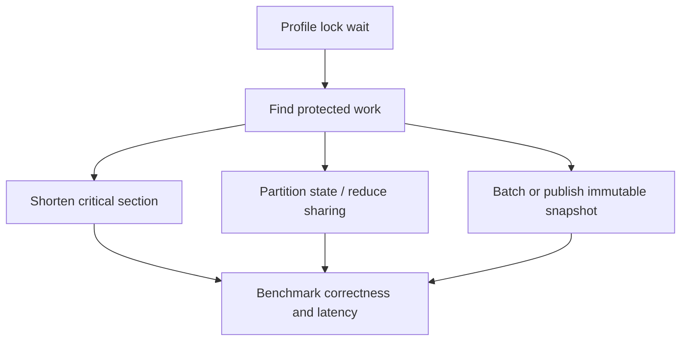

# 152. How do you reduce lock contention?

> **Section:** Performance and Debugging · **Related:** [151. What is lock contention](151.%20What%20is%20lock%20contention.md)

## TL;DR

Measure the contended lock first, then reduce protected work or reduce how many tasks share mutable state.

## Techniques

Keep critical sections short; never perform I/O, callbacks, or expensive computation while holding a lock. Consider partitioning state by key, batching updates, immutable snapshots, or a concurrent utility. Validate that changes preserve invariants.

## Architect insight

Optimize the measured hot lock, not every synchronized block. Fine-grained locking and lock-free algorithms can increase complexity, memory use, or retry costs; re-profile after each change.

**Pitfall:** Moving work outside a lock without a consistency design can introduce races or expose partially updated state.

## Related questions

- [151. What is lock contention](151.%20What%20is%20lock%20contention.md)
- [158. How do you find contention hotspots](158.%20How%20do%20you%20find%20contention%20hotspots.md)
