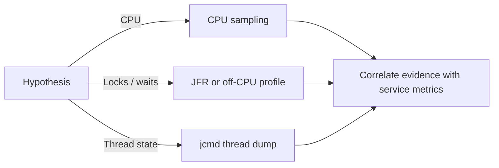

# 153. What are thread profiling tools in Java?

> **Section:** Performance and Debugging · **Related:** [150. How do flame graphs help](150.%20How%20do%20flame%20graphs%20help.md)

## TL;DR

Use JDK Flight Recorder (JFR), Java Mission Control (JMC), `jcmd`, thread dumps, and—where appropriate—VisualVM or async-profiler.

JFR records configurable runtime events; JMC helps inspect recordings. `jcmd` supports diagnostics such as thread dumps and JFR control. async-profiler can sample CPU, allocation, and off-CPU/lock events. Choose based on the suspected bottleneck and consider permissions, recording duration, and production overhead.



## Example

```shell
jcmd <pid> Thread.print
jcmd <pid> JFR.start name=profile settings=profile duration=60s filename=profile.jfr
```

Exact command options can vary by JDK; check `jcmd <pid> help JFR.start`.

**Pitfall:** A profile collected without representative load may identify the wrong hot path.

## Related questions

- [150. How do flame graphs help](150.%20How%20do%20flame%20graphs%20help.md)
- [154. CPU versus lock bottlenecks](154.%20CPU%20versus%20lock%20bottlenecks.md)
