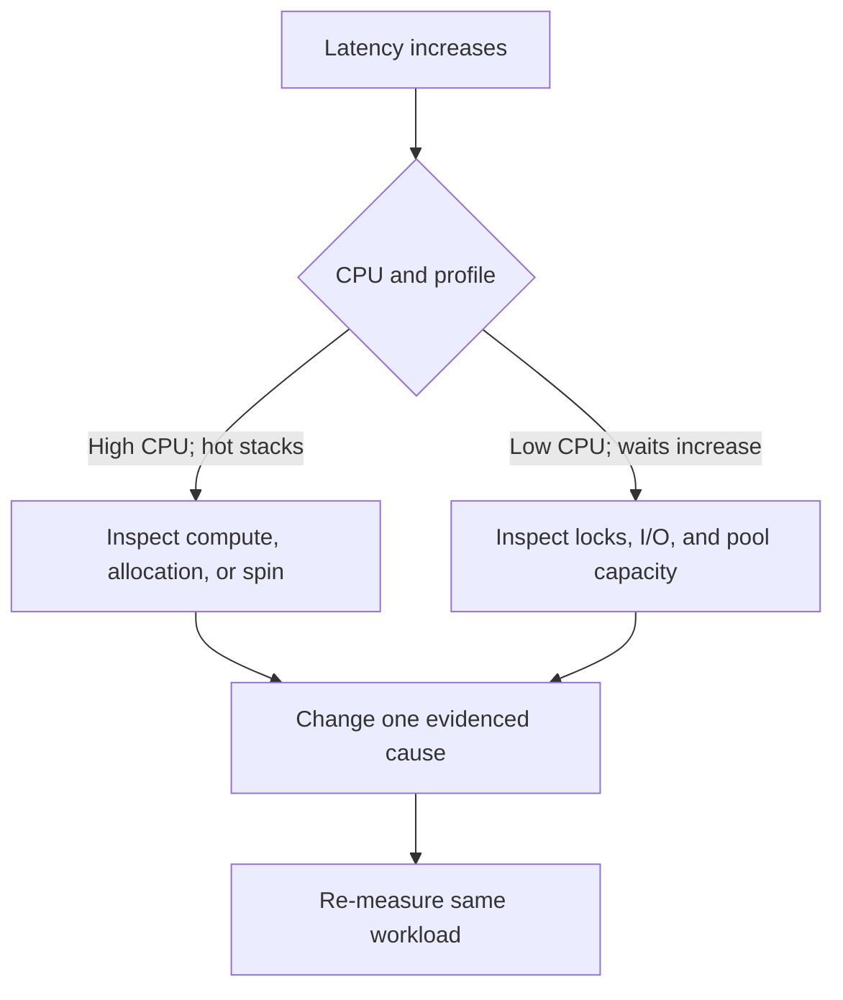

# 154. How do you analyze CPU vs lock bottlenecks?

> **Section:** Performance and Debugging · **Related:** [158. How do you find contention hotspots](158.%20How%20do%20you%20find%20contention%20hotspots.md)

## TL;DR

High CPU with hot stacks suggests computation, allocation, or spinning; rising latency with low CPU and persistent waits suggests blocking, lock contention, or pool capacity.

Neither signature is definitive on its own. Compare process and per-thread CPU, JFR lock events, thread dumps, queue depth, throughput, and request percentiles over the same interval.

## Practical insight

Measure both service and runtime signals: utilization explains where time may go, while latency distributions and completed operations show user impact. Lock waits may coexist with CPU load from other threads.

**Pitfall:** Low CPU does not prove a lock bottleneck; threads may be waiting on network, disk, or an undersized executor.

## Related questions

- [153. Java thread-profiling tools](153.%20Java%20thread-profiling%20tools.md)
- [158. How do you find contention hotspots](158.%20How%20do%20you%20find%20contention%20hotspots.md)
