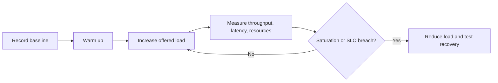

# 155. What is scalability testing for concurrency?

> **Section:** Performance and Debugging · **Related:** [156. How do you measure throughput under load](156.%20How%20do%20you%20measure%20throughput%20under%20load.md)

## TL;DR

Scalability testing measures how throughput, latency, errors, and resource use change as concurrency, data size, or nodes increase.

Use a realistic workload, warm-up, a stable measurement interval, and a recorded baseline. Increase load in controlled steps; observe saturation and recovery after load is reduced. Track p95/p99 latency, successful completions, errors, CPU, memory, and queue depth.

## Architect insight

Keep data, hardware, JVM settings, and run duration controlled when comparing versions. Test beyond the expected operating point to discover queue growth and overload behavior, not just peak throughput.

**Pitfall:** A closed-loop test can hide overload because clients slow down as response time rises; choose load generation to match the question being tested.

## Related questions

- [156. How do you measure throughput under load](156.%20How%20do%20you%20measure%20throughput%20under%20load.md)
- [159. What is thread oversubscription](159.%20What%20is%20thread%20oversubscription.md)
