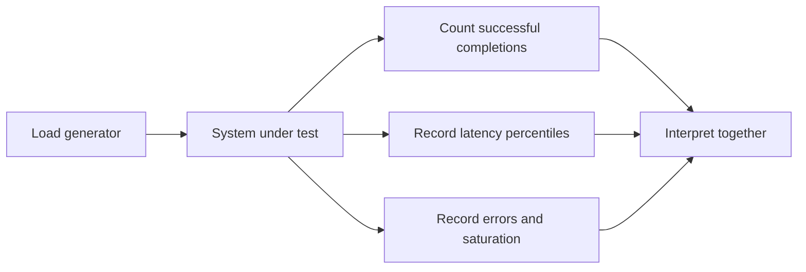

# 156. How do you measure throughput under load?

> **Section:** Performance and Debugging · **Related:** [155. What is scalability testing](155.%20What%20is%20scalability%20testing.md)

## TL;DR

Count successful completed operations per unit time, and report latency distributions, errors, and resource use alongside the rate.

Warm up the JVM, define a steady-state interval, and control workload data and environment. For service-capacity tests, use an open-loop or coordinated-omission-aware generator so delayed responses do not silently reduce offered load. Record offered and completed rates.

```text
Throughput = successful completions / measurement duration
```



## Practical insight

Throughput and latency answer different questions: a high average rate can coexist with unacceptable p99 latency. Keep concurrency and offered-load settings constant in comparisons and disclose them with results.

**Pitfall:** Reporting only requests sent, or only an average latency, can conceal failures and long-tail stalls.

## Related questions

- [155. What is scalability testing](155.%20What%20is%20scalability%20testing.md)
- [154. CPU versus lock bottlenecks](154.%20CPU%20versus%20lock%20bottlenecks.md)
