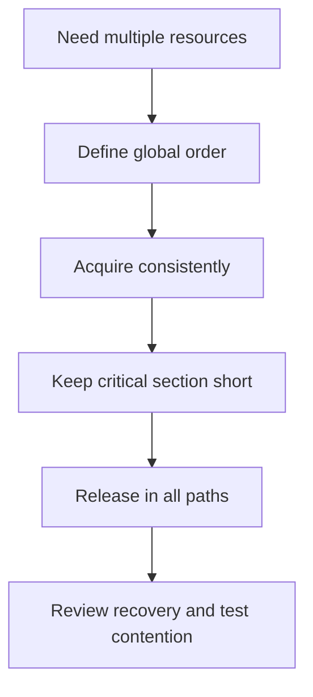

# 157. What strategies prevent deadlock?

> **Section:** Performance and Debugging · **Related:** [141. What is a deadlock](141.%20What%20is%20a%20deadlock.md)

## TL;DR

Prevent lock cycles with a global lock order, short critical sections, and minimal nested locking.

Acquire multiple locks in the same order on every path. Avoid calling callbacks or unknown code while holding a lock. Prefer higher-level concurrent utilities where they express the required coordination. Use timed or interruptible acquisition only when the application has a safe recovery policy.

## Architect insight

Timeouts can surface a stuck acquisition but cannot guarantee consistency if work has partially mutated state. Design cancellation and rollback semantics explicitly.

**Pitfall:** A local lock order is insufficient if another code path acquires the same locks in reverse order.

## Related questions

- [141. What is a deadlock](141.%20What%20is%20a%20deadlock.md)
- [142. How can you detect deadlocks](142.%20How%20can%20you%20detect%20deadlocks.md)
