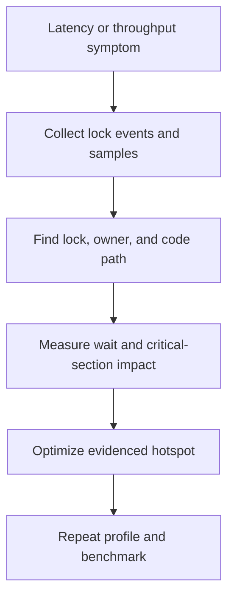

# 158. How do you detect contention hotspots?

> **Section:** Performance and Debugging · **Related:** [151. What is lock contention](151.%20What%20is%20lock%20contention.md)

## TL;DR

Correlate lock-wait evidence with the affected code path, throughput, and latency; do not infer a hotspot from thread count alone.

Capture JFR monitor/synchronizer contention events or profiler lock samples, then inspect repeated thread dumps for blocked stacks and owners. Identify the lock, critical-section duration, and workload using it. Compare waits to service percentiles and queueing over the same interval.

## Practical insight

A frequently acquired lock may be harmless if uncontended. Optimize based on time waiting and user-visible impact, not event count alone.

**Pitfall:** A flame graph of CPU samples may miss threads blocked on a lock; select a waiting/lock event profile for that hypothesis.

## Related questions

- [150. How do flame graphs help](150.%20How%20do%20flame%20graphs%20help.md)
- [152. How can lock contention be reduced](152.%20How%20can%20lock%20contention%20be%20reduced.md)
