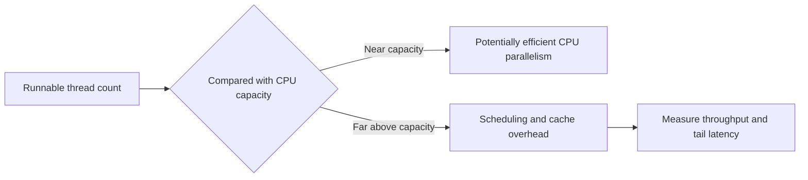

# 159. How does oversubscription of threads affect performance?

> **Section:** Performance and Debugging · **Related:** [160. Context-switch overhead](160.%20Context-switch%20overhead.md)

## TL;DR

Oversubscription occurs when runnable threads substantially outnumber available CPU execution capacity.

It can increase scheduling and context-switch work, disrupt caches, and worsen latency. Some extra concurrency is useful for tasks blocked on I/O, so there is no single correct thread count for every workload. Use available processors as a starting point for CPU-bound pools; bound blocking pools and downstream concurrency separately.

## Practical insight

Benchmark realistic workload mixes and inspect runnable-thread counts, CPU utilization, queueing, and context-switch activity. Virtual threads reduce the cost of many blocked tasks, but do not increase CPU cores or downstream capacity.

**Pitfall:** Total thread count is not the same as runnable thread count; many waiting threads may be appropriate.

## Related questions

- [160. Context-switch overhead](160.%20Context-switch%20overhead.md)
- [156. How do you measure throughput under load](156.%20How%20do%20you%20measure%20throughput%20under%20load.md)
