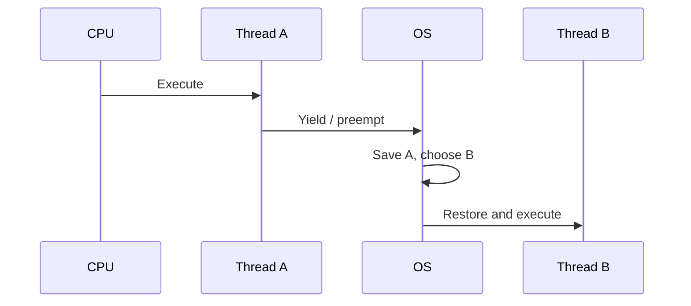

# 160. How does context switching overhead affect performance?

> **Section:** Performance and Debugging · **Related:** [159. What is thread oversubscription](159.%20What%20is%20thread%20oversubscription.md)

## TL;DR

A context switch saves one execution context and restores another; frequent switching consumes CPU and can disturb caches and branch predictors.

Switching is normal and is not automatically the dominant cost. Excessive runnable threads, fine-grained tasks, or needless wakeups can make scheduling overhead significant. Measure scheduler activity together with CPU profiles, task completion rate, and tail latency.

## Architect insight

Reduce unnecessary task fragmentation and bound runnable CPU work; avoid assuming that eliminating every switch improves performance. Re-measure because a change may simply shift cost to queueing or work per task.

**Pitfall:** Adding workers to improve throughput can worsen context switching when CPU is already saturated.

## Related questions

- [159. What is thread oversubscription](159.%20What%20is%20thread%20oversubscription.md)
- [155. What is scalability testing](155.%20What%20is%20scalability%20testing.md)
