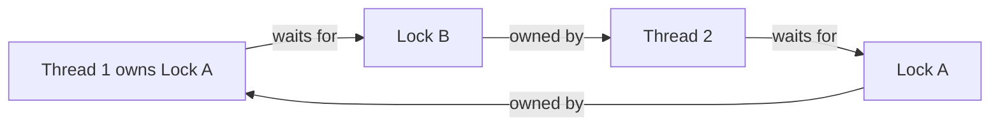
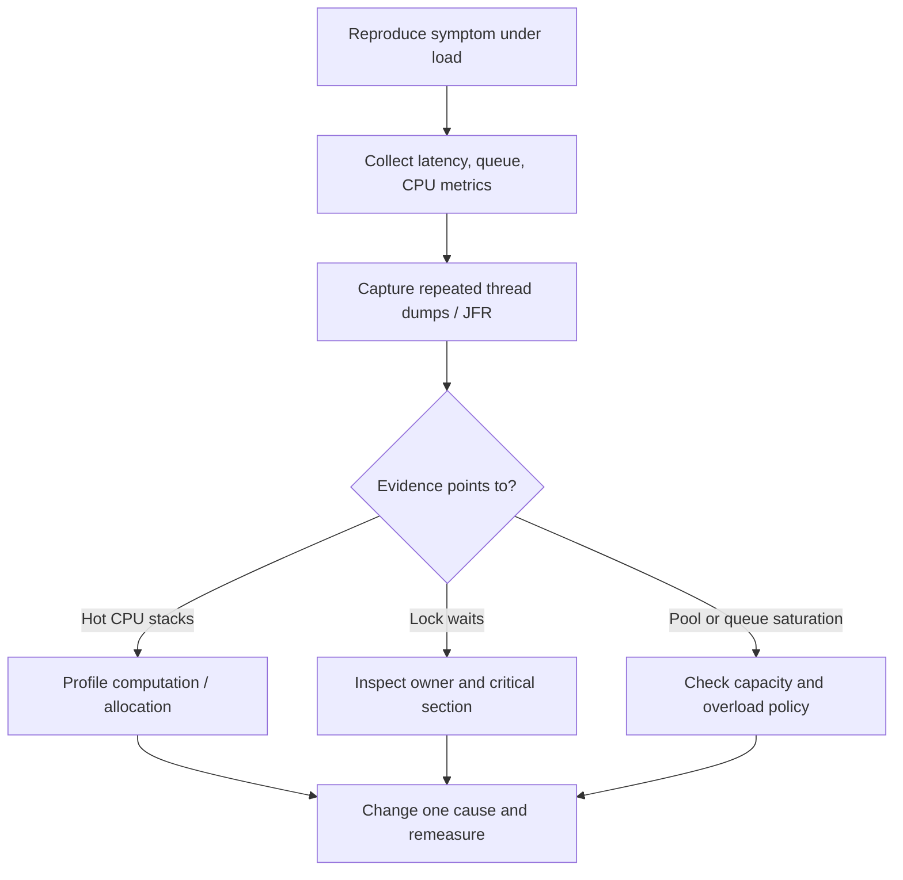
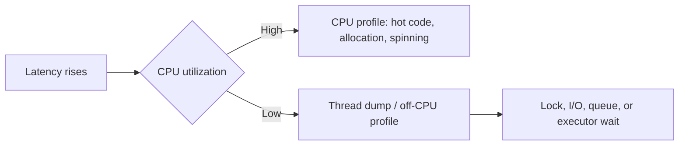

# 8. Performance and Debugging

> Complete guide to questions 141–160 in the [master index](../00-INDEX.md). Capture evidence from representative workloads before changing concurrency design.

**Related code:** [`Worker.java`](../../src/com/java/multiplelocks/synchronizedcodeblocks/Worker.java).

## Answers

### 141. What is a deadlock?

A deadlock is a cycle of threads where each waits for a resource held by another in the cycle, so none can progress. Classic lock deadlock requires mutual exclusion, hold-and-wait, no preemption, and circular wait. Deadlocks can also involve futures, callbacks, executors, or application-level resources.

### 142. How can you detect deadlocks?

Capture a JVM thread dump (`jcmd <pid> Thread.print` or `jstack <pid>`) and inspect reported deadlock cycles, lock owners, and repeated waiting stacks. `ThreadMXBean.findDeadlockedThreads()` can detect monitor and ownable-synchronizer cycles programmatically. A single snapshot may miss intermittent cycles; sample repeatedly and correlate with health symptoms.

### 143. What is livelock?

In a livelock, threads keep executing and reacting to one another but make no useful progress—for example, both repeatedly back off when the other does. CPU may remain busy, unlike a simple deadlock. Add randomized or asymmetric backoff, ownership, or a bounded retry policy.

### 144. Livelock versus deadlock

Deadlocked threads are blocked and stationary in a wait cycle; livelocked threads are active but fail to advance the system state. Both violate progress. Thread dumps reveal blocked waits for deadlock, while CPU profiles, repeated retry stacks, and unchanged business metrics help reveal livelock.

### 145. What is thread starvation?

Starvation occurs when a thread is continually denied CPU time, a lock, executor capacity, or another resource it needs. It may be caused by unfair scheduling, long-running tasks, priority choices, or a saturated shared pool. Detect it by comparing wait duration and task age, not merely thread state.

### 146. How can starvation be prevented?

Bound task execution, avoid monopolizing shared executors, isolate blocking work, and consider fair locks or queues only when appropriate. Use admission control and quotas so one workload cannot occupy all workers. Fairness may lower throughput; test progress and tail latency under contention.

### 147. What is fairness in thread scheduling?

Fairness means contenders receive opportunities in a policy-defined order or without indefinite postponement. Java does not guarantee portable OS thread scheduling fairness. Some locks and queues offer fairness modes, but they cannot guarantee CPU scheduling or end-to-end service fairness.

### 148. How do you analyze a thread dump?

Take multiple timestamped dumps during the symptom. Group threads by state and repeated stack, inspect monitor/synchronizer owners and wait chains, identify executor workers and task queues, and compare CPU usage. Correlate with application metrics and logs; a thread dump is a point-in-time snapshot, not a root cause by itself.

### 149. How do you identify blocked threads?

Look for `BLOCKED` threads waiting to enter a monitor and note the owning thread/object shown in the dump. Also inspect `WAITING`/`TIMED_WAITING` stacks: those can indicate normal queue polling, condition waits, or a stuck dependency. Compare repeated dumps to distinguish persistent blockage from brief contention.

### 150. How do flame graphs help?

A flame graph aggregates sampled stack traces; width represents sample frequency, not elapsed time of one call. CPU flame graphs expose hot computation; off-CPU or lock profiles reveal waiting and contention. Use the right event type, collect under representative load, and interpret with wall-clock and latency metrics.

### 151. What is lock contention?

Lock contention is competition for an exclusive or limited synchronization resource. It causes waiting, handoff overhead, cache-coherence traffic, and can serialize otherwise parallel work. A high lock count alone is not enough: inspect wait time, affected throughput, and critical-section stacks.

### 152. How can lock contention be reduced?

First shorten protected work and avoid I/O, callbacks, or expensive computation while holding a lock. Then consider reducing shared mutable state, partitioning by key, batching updates, or using immutable snapshots. Finer locks and lock-free algorithms add complexity; profile after each change.

### 153. Java thread-profiling tools

Useful JDK tools include Java Flight Recorder (JFR) and Java Mission Control (JMC), `jcmd`, thread dumps, and VisualVM where available. Native profilers such as async-profiler can sample CPU, allocation, and off-CPU/lock events. Choose sampling suited to the hypothesis and keep production overhead/permissions in mind.

### 154. CPU versus lock bottlenecks

High CPU with hot stacks suggests computation, allocation, or spinning; low CPU with rising latency and blocked/waiting threads suggests lock, I/O, or pool-capacity waits. Compare process CPU, per-thread CPU, JFR lock events, thread dumps, queue depth, and request percentiles over the same interval.

### 155. What is scalability testing?

Scalability testing measures how throughput, latency, resource use, and error rate change as concurrency, data size, or nodes increase. Include a realistic workload, warm-up, steady-state interval, and a baseline. Test beyond the expected operating point to identify saturation and recovery behavior.

### 156. How do you measure throughput under load?

Count completed successful operations per unit time, while reporting latency distributions (especially p95/p99), errors, and resource use. Use an open-loop or otherwise coordinated-omission-aware load generator when testing service capacity, warm up the JVM, and control data, environment, and run duration.

### 157. How can deadlocks be prevented?

Use a global lock order, acquire multiple locks consistently, minimize nested locking, avoid calling unknown code while holding locks, and use time-bounded/interruptible acquisition when recovery is meaningful. Prefer higher-level concurrent utilities. Timeouts detect some stalls but do not automatically restore consistency.

### 158. How do you find contention hotspots?

Correlate lock wait events and monitor contention stacks from JFR/profilers with thread dumps, throughput, and latency. Identify the specific lock, code path, and critical-section duration. Do not infer a hotspot solely from a large thread count or frequent state samples.

### 159. What is thread oversubscription?

Oversubscription means runnable threads substantially exceed available CPU capacity. It increases scheduling and context-switch costs, cache disruption, and latency; for blocking workloads, some extra concurrency may be useful. Size CPU pools near available processors as a starting point, then benchmark; bound blocking pools separately.

### 160. Context-switch overhead

A context switch saves one execution context and restores another; frequent switching consumes CPU and can disrupt caches and branch predictors. It is not always the dominant cost, but excessive runnable threads and fine-grained tasks can make it significant. Measure scheduler activity and reduce unnecessary wakeups/task fragmentation.

## Diagrams

### Deadlock wait-for cycle

### Diagnose before optimizing

### CPU and waiting signatures

## Investigation checklist

- Preserve timestamps, JVM version, workload, and environment with every capture.
- Compare at least two dumps; investigate recurring stacks and owners, not isolated states.
- Include tail latency and errors when evaluating a throughput optimization.
- Change one suspected bottleneck at a time and retain a rollback path.
