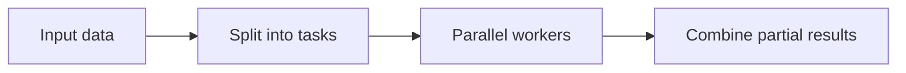

# 161. What are parallel streams in Java?

> **Section:** Reactive and Modern Approaches · **Related:** [162. Parallel streams versus manual threads](162.%20Parallel%20streams%20versus%20manual%20threads.md)

## TL;DR

Parallel streams split stream work into tasks, typically scheduled through the shared `ForkJoinPool`, then combine results.

```java
long total = values.parallelStream()
        .mapToLong(this::cpuBoundCost)
        .sum();
```

They fit sufficiently large, independent CPU-bound operations with associative reductions. Keep operations stateless and avoid side effects. Blocking calls and shared mutable state can cause contention or correctness bugs; small or unbalanced inputs may cost more to split and combine than they save.



## Architect insight

Benchmark against sequential processing on representative inputs, and account for common-pool interference with unrelated work.

**Pitfall:** A parallel stream is not a dedicated executor with an isolated blocking policy.

## Related questions

- [162. Parallel streams versus manual threads](162.%20Parallel%20streams%20versus%20manual%20threads.md)
- [173. Risks of parallel streams](173.%20Risks%20of%20parallel%20streams.md)
