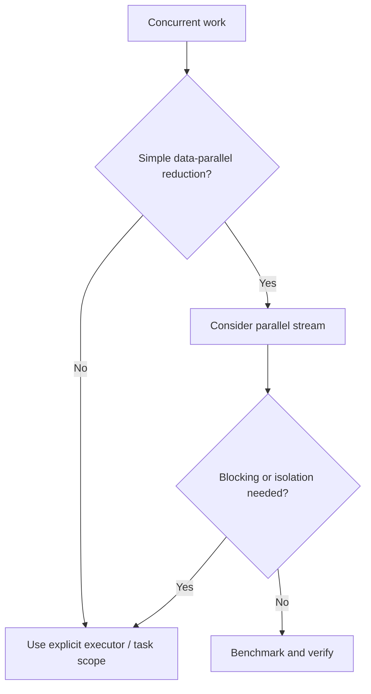

# 162. How do parallel streams differ from manual threads?

> **Section:** Reactive and Modern Approaches · **Related:** [161. What are parallel streams](161.%20What%20are%20parallel%20streams.md)

## TL;DR

Parallel streams offer concise split-and-reduce for data-parallel work; explicit executors provide clearer control of scheduling, cancellation, isolation, and lifecycle.

Choose a parallel stream for a simple, stateless CPU operation with a correct associative reduction. Choose managed tasks or an executor when work blocks, needs a dedicated capacity budget, has explicit cancellation, or needs per-task lifecycle control.

## Practical insight

Manual `Thread` creation is rarely a substitute for a managed executor. Consider virtual threads for many blocking tasks, while retaining limits for CPU and downstream resources.

**Pitfall:** Do not assume parallel streams use an isolated pool or make blocking calls nonblocking.

## Related questions

- [161. What are parallel streams](161.%20What%20are%20parallel%20streams.md)
- [168. Async I/O versus thread-per-request](168.%20Async%20I-O%20versus%20thread-per-request.md)
