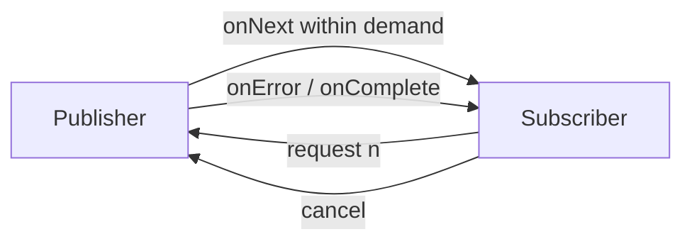

# 163. What is reactive programming?

> **Section:** Reactive and Modern Approaches · **Related:** [164. What is Reactor](164.%20What%20is%20Reactor.md)

## TL;DR

Reactive programming models values or events that arrive over time and composes transformations and asynchronous boundaries.

Reactive Streams adds a demand protocol so a subscriber can signal how many elements it is ready to receive. This can regulate flow between publishers and subscribers. It does not by itself make every library asynchronous or eliminate state, failure, cancellation, and capacity concerns.

## Architect insight

Reactive design can support many concurrent I/O operations with fewer dedicated threads, but it adds an asynchronous programming model. Adopt it when the ecosystem and workload justify the complexity.

**Pitfall:** An asynchronous wrapper around a blocking call still blocks whichever thread executes that call.

## Related questions

- [164. What is Reactor](164.%20What%20is%20Reactor.md)
- [166. Reactive Streams versus futures](166.%20Reactive%20Streams%20versus%20futures.md)
