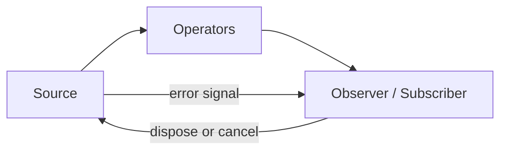

# 165. What is RxJava?

> **Section:** Reactive and Modern Approaches · **Related:** [163. What is reactive programming](163.%20What%20is%20reactive%20programming.md)

## TL;DR

RxJava is a JVM ReactiveX library for composing asynchronous or event-based sequences with operators, scheduling, and error handling.

Its types and backpressure behavior depend on the API: `Observable` is not backpressured, while `Flowable` supports Reactive Streams demand. Choose the appropriate type for the source and rate relationship. Dispose subscriptions when their owning work ends so unwanted work can stop and resources can be released.

## Architect insight

Pin the RxJava major version and consult its API because available types and semantics evolve. Scheduling alone does not make a blocking dependency nonblocking.

**Pitfall:** An untracked subscription can continue doing work after the consumer no longer needs the result.

## Related questions

- [164. What is Reactor](164.%20What%20is%20Reactor.md)
- [166. Reactive Streams versus futures](166.%20Reactive%20Streams%20versus%20futures.md)
