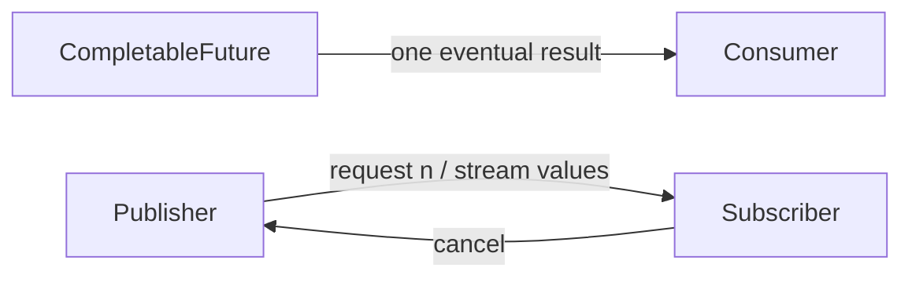

# 166. How do reactive streams differ from futures?

> **Section:** Reactive and Modern Approaches · **Related:** [163. What is reactive programming](163.%20What%20is%20reactive%20programming.md)

## TL;DR

A future usually represents one eventual result; a Reactive Streams publisher can represent zero or many asynchronous values with demand and cancellation.

`CompletableFuture` composes one-shot stages and is useful for finite results. Reactive Streams fits streams of items where consumers need flow control. Both can represent asynchronous completion, but neither guarantees that the underlying I/O client is nonblocking.

## Practical insight

Choose the abstraction matching the cardinality, backpressure, and cancellation needs. Bridge between APIs deliberately and preserve error and cancellation semantics.

**Pitfall:** Wrapping a synchronous blocking call in a future merely moves the blocking to a worker; it does not create nonblocking I/O.

## Related questions

- [167. What is asynchronous I/O](167.%20What%20is%20asynchronous%20I-O.md)
- [176. How does backpressure work in Reactor](176.%20How%20does%20backpressure%20work%20in%20Reactor.md)
