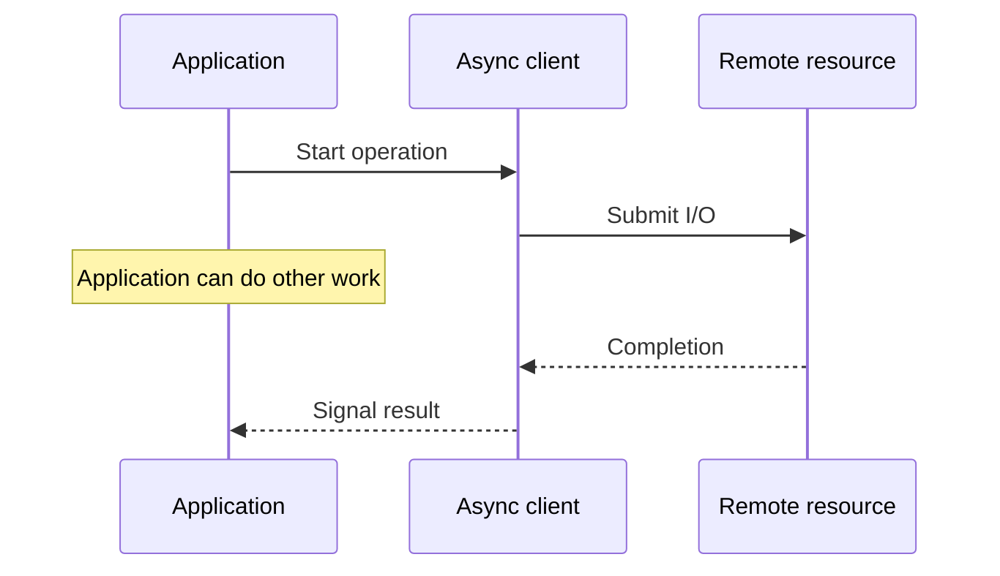

# 167. What is async I/O?

> **Section:** Reactive and Modern Approaches · **Related:** [168. Async I/O versus thread-per-request](168.%20Async%20I-O%20versus%20thread-per-request.md)

## TL;DR

Asynchronous I/O initiates an operation and observes completion later, without requiring an application thread to wait for the operation when the runtime, OS, and client support it.

Completion may be delivered through callbacks, futures, or event loops. Confirm the whole path—from framework through driver and protocol—is async-aware. A single blocking dependency can still occupy an event-loop or worker thread.

## Architect insight

Async I/O changes how waiting is represented, not the finite capacity of sockets, connections, or remote services. Add timeouts, cancellation, and concurrency limits.

**Pitfall:** A method named `async` may still perform blocking work internally; verify the library and driver behavior.

## Related questions

- [166. Reactive Streams versus futures](166.%20Reactive%20Streams%20versus%20futures.md)
- [174. Blocking calls in reactive systems](174.%20Blocking%20calls%20in%20reactive%20systems.md)
