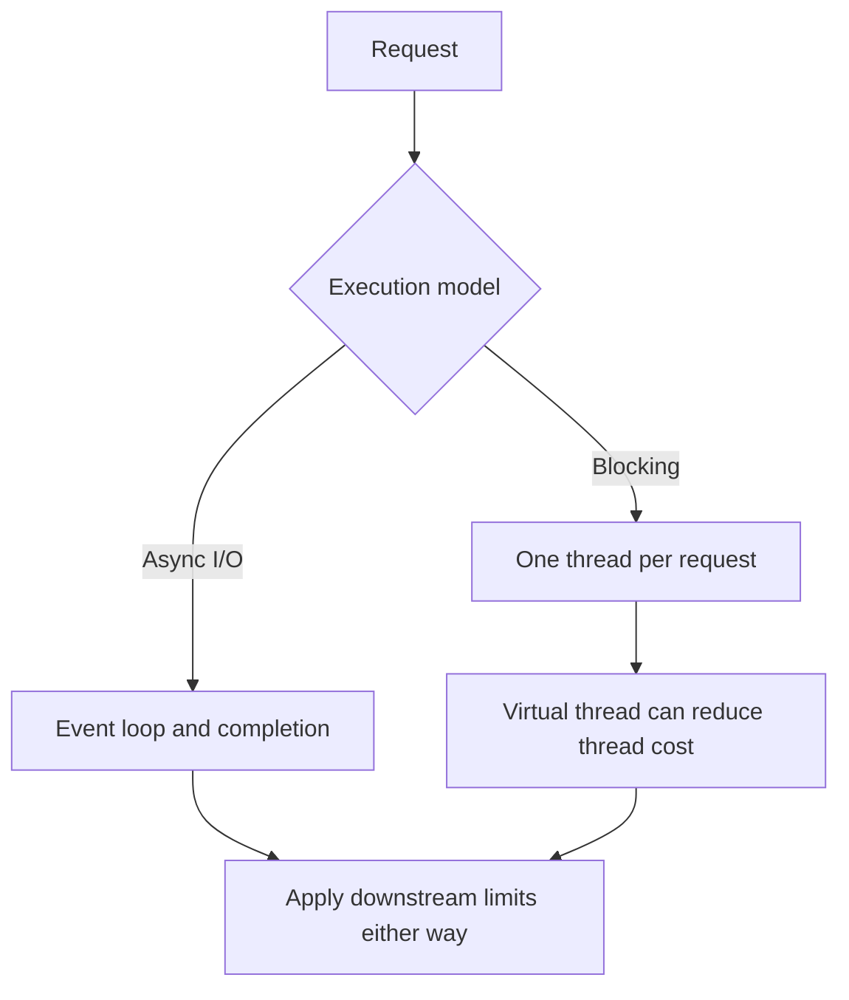

# 168. How does async I/O differ from thread-per-request?

> **Section:** Reactive and Modern Approaches · **Related:** [170. What are virtual threads](170.%20What%20are%20virtual%20threads.md)

## TL;DR

Async I/O uses completion signals and often event loops to manage outstanding operations; thread-per-request uses a thread for each request's control flow.

Async code can handle many pending I/O operations with fewer threads, but requires async-aware libraries and explicit error/cancellation flow. Platform-thread-per-request is straightforward but consumes an OS thread while blocked. Virtual threads make blocking-style request code more scalable for many I/O-bound tasks, without removing downstream limits.

## Architect insight

Compare end-to-end behavior, not thread count alone. Both models need timeouts, overload handling, and limits for databases and remote services.

**Pitfall:** Async I/O does not mean requests are free; queues and scarce connections can still saturate.

## Related questions

- [167. What is asynchronous I/O](167.%20What%20is%20asynchronous%20I-O.md)
- [170. What are virtual threads](170.%20What%20are%20virtual%20threads.md)
