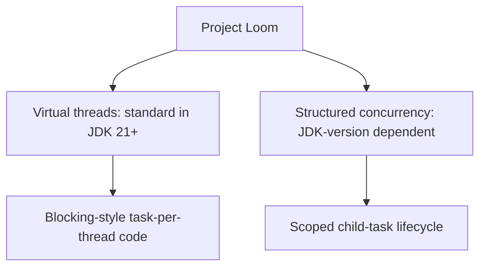

# 169. What is Project Loom?

> **Section:** Reactive and Modern Approaches · **Related:** [170. What are virtual threads](170.%20What%20are%20virtual%20threads.md)

## TL;DR

Project Loom is the OpenJDK effort that brought lightweight virtual threads and structured-concurrency work to Java.

Virtual threads are a standard feature in modern Java (finalized in JDK 21). Structured concurrency APIs have had release-dependent preview status and signatures; check the target JDK's documentation and compile against that release before relying on them.

## Architect insight

Loom reduces the cost of expressing concurrency; it does not increase CPU, make shared state safe, or remove the need to budget database and service capacity.

**Pitfall:** Avoid treating a preview API as stable across JDK upgrades; preview features can change and require explicit enablement for that release.

## Related questions

- [170. What are virtual threads](170.%20What%20are%20virtual%20threads.md)
- [172. How does structured concurrency improve readability](172.%20How%20does%20structured%20concurrency%20improve%20readability.md)
