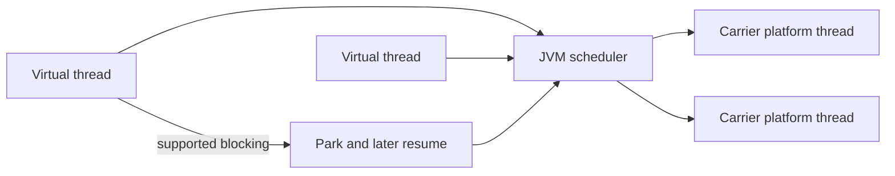

# 170. What are virtual threads?

> **Section:** Reactive and Modern Approaches · **Related:** [171. How do virtual threads reduce resource use](171.%20How%20do%20virtual%20threads%20reduce%20resource%20use.md)

## TL;DR

Virtual threads are lightweight `Thread` instances scheduled by the JVM over a smaller set of carrier platform threads. They are standard starting with JDK 21.

```java
Thread.startVirtualThread(() -> {
    handleBlockingRequest();
});
```

They suit high concurrency of mostly blocking I/O because supported blocking can suspend a virtual thread without reserving one OS thread per wait. They do not accelerate CPU-bound work or make shared mutable state thread-safe.



## Practical insight

Use task-per-virtual-thread for suitable blocking workloads, but still apply admission control and limits to scarce dependencies.

**Pitfall:** A large number of inexpensive virtual threads can overwhelm a database or remote service just as easily as other concurrency models.

## Related questions

- [169. What is Project Loom](169.%20What%20is%20Project%20Loom.md)
- [171. How do virtual threads reduce resource use](171.%20How%20do%20virtual%20threads%20reduce%20resource%20use.md)
- [180. Migrating pools to virtual threads](180.%20Migrating%20pools%20to%20virtual%20threads.md)
