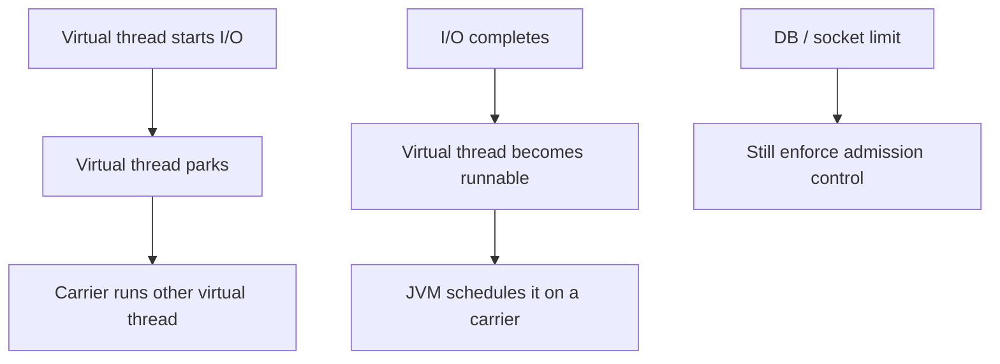

# 171. How do virtual threads reduce resource usage?

> **Section:** Reactive and Modern Approaches · **Related:** [170. What are virtual threads](170.%20What%20are%20virtual%20threads.md)

## TL;DR

When a virtual thread blocks in supported operations, the JVM can suspend it and use its carrier platform thread for other work, avoiding one OS thread per blocked task.

This makes thread-per-task code practical at higher I/O concurrency. Virtual threads still consume heap and application resources; file descriptors, database connections, remote capacity, and CPU remain finite.

## Architect insight

Protect scarce downstream resources with connection pools, semaphores, rate limits, or bounded admission. Size limits from service capacity and latency objectives, not the number of virtual threads.

**Pitfall:** Virtual threads reduce the cost of blocked threads; they do not make an unbounded number of database calls safe.

## Related questions

- [170. What are virtual threads](170.%20What%20are%20virtual%20threads.md)
- [180. Migrating pools to virtual threads](180.%20Migrating%20pools%20to%20virtual%20threads.md)
