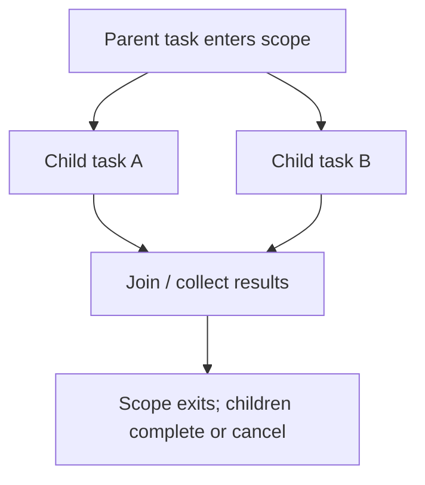

# 172. How does structured concurrency improve readability?

> **Section:** Reactive and Modern Approaches · **Related:** [169. What is Project Loom](169.%20What%20is%20Project%20Loom.md)

## TL;DR

Structured concurrency groups related child tasks in a lexical scope, making their lifetime, joining, results, and failure handling visible together.

A parent scope can provide a coherent boundary for waiting and cancellation instead of scattering futures across methods. Define whether a child failure cancels siblings and how cancellation propagates. Java structured-concurrency APIs and preview status vary by JDK; verify the target release.

## Architect insight

Structured lifetime improves ownership and observability but does not automatically make child operations correct or bounded. Keep scopes focused and set timeouts where needed.

**Pitfall:** Do not copy preview API examples across JDK versions without checking the exact API and required flags.

## Related questions

- [169. What is Project Loom](169.%20What%20is%20Project%20Loom.md)
- [180. Migrating pools to virtual threads](180.%20Migrating%20pools%20to%20virtual%20threads.md)
