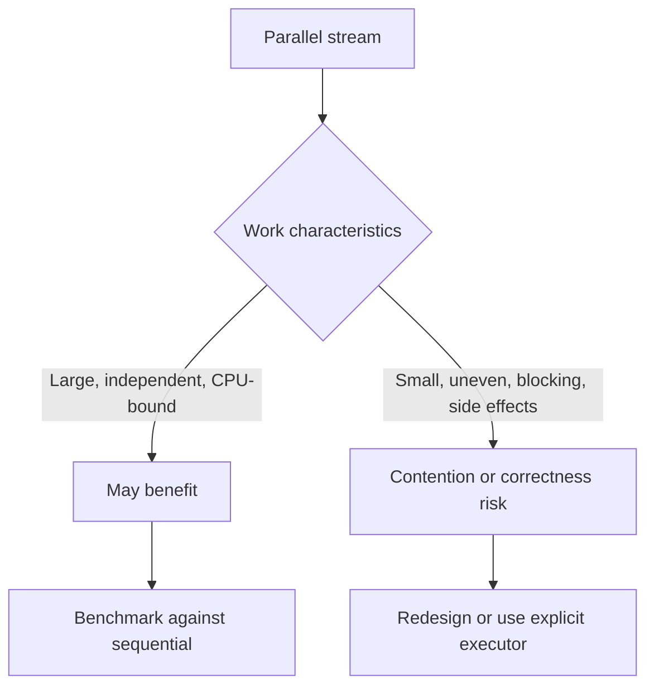

# 173. What are the risks of parallel streams?

> **Section:** Reactive and Modern Approaches · **Related:** [161. What are parallel streams](161.%20What%20are%20parallel%20streams.md)

## TL;DR

Parallel streams can contend on the shared common pool, perform poorly on small or uneven workloads, and expose races in side effects.

Prefer stateless transformations and associative reductions. Encounter order can constrain optimizations. Blocking work can occupy shared workers and interfere with unrelated computations; use explicit, bounded execution policies when isolation or blocking control matters.

## Practical insight

Always compare with a sequential baseline on realistic data, under representative load. Ensure reduction operations are associative and avoid shared mutable accumulators.

**Pitfall:** A thread-safe side effect may still serialize the stream and erase its performance benefit.

## Related questions

- [161. What are parallel streams](161.%20What%20are%20parallel%20streams.md)
- [162. Parallel streams versus manual threads](162.%20Parallel%20streams%20versus%20manual%20threads.md)
