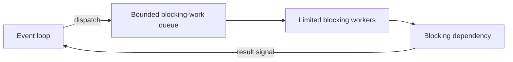

# 174. How do you handle blocking calls in reactive systems?

> **Section:** Reactive and Modern Approaches · **Related:** [175. What is a scheduler](175.%20What%20is%20a%20scheduler.md)

## TL;DR

Do not block event-loop threads. Prefer an async client; if blocking is unavoidable, isolate it on a bounded dedicated scheduler or executor.

In Reactor, a typical pattern is to defer the blocking call and move subscription work to a bounded-elastic scheduler:

```java
Mono.fromCallable(this::blockingCall)
    .subscribeOn(Schedulers.boundedElastic());
```

Bound concurrency, configure timeouts, propagate cancellation, and observe queue saturation. A scheduler wrapper does not convert the dependency into nonblocking I/O.



## Architect insight

Prefer an end-to-end async driver where available. Size isolation based on downstream capacity, and define overload behavior rather than allowing unbounded queued work.

**Pitfall:** `subscribeOn` can relocate blocking but cannot make it disappear; an unbounded or undersized pool only changes where overload accumulates.

## Related questions

- [164. What is Reactor](164.%20What%20is%20Reactor.md)
- [175. What is a scheduler](175.%20What%20is%20a%20scheduler.md)
