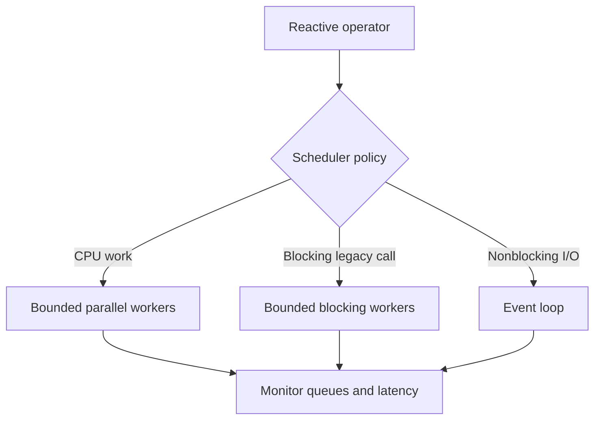

# 175. What is a scheduler in reactive frameworks?

> **Section:** Reactive and Modern Approaches · **Related:** [174. Blocking calls in reactive systems](174.%20Blocking%20calls%20in%20reactive%20systems.md)

## TL;DR

A reactive scheduler determines where and when operators execute; common choices include event-loop, single-thread, parallel CPU, and bounded-elastic patterns.

A scheduler's worker count, queueing, and lifecycle affect capacity and latency. It is more than a thread label: switching execution context can add handoffs, and queues can saturate. Use framework defaults deliberately and isolate blocking work without putting it on an event loop.

## Architect insight

Choose schedulers according to the work and the capacity budget. Make overload visible with metrics and bounded queues where supported.

**Pitfall:** Moving blocking work to a scheduler does not limit the number of database connections unless that resource is bounded separately.

## Related questions

- [174. Blocking calls in reactive systems](174.%20Blocking%20calls%20in%20reactive%20systems.md)
- [178. Reactive versus traditional thread pools](178.%20Reactive%20versus%20traditional%20thread%20pools.md)
