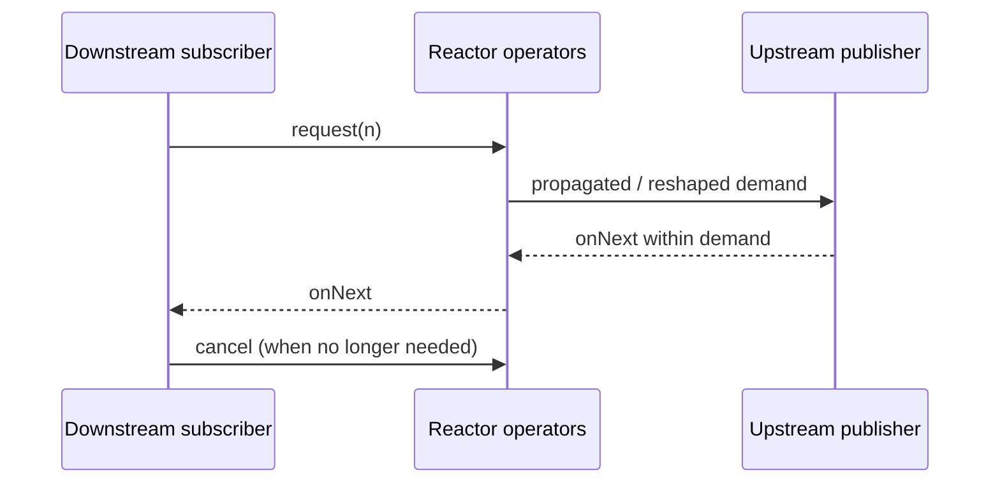

# 176. How does backpressure work in Reactor?

> **Section:** Reactive and Modern Approaches · **Related:** [164. What is Reactor](164.%20What%20is%20Reactor.md)

## TL;DR

Reactor `Flux` follows Reactive Streams demand: downstream requests a number of elements, and upstream must not emit beyond outstanding demand.

Operators can reshape requests or buffer between stages; inspect their documented behavior and configure bounded queues where available. Backpressure regulates element flow, but does not automatically reserve database connections, limit remote requests, or constrain unrelated sources.

## Practical insight

Audit every boundary: source, operators, scheduler queues, and external resources. A bounded demand protocol is useful only if buffering and concurrency remain bounded through the pipeline.

**Pitfall:** Backpressure is not a universal “slow consumer protection” switch; a non-compliant source or unbounded buffer can still cause overload.

## Related questions

- [163. What is reactive programming](163.%20What%20is%20reactive%20programming.md)
- [164. What is Reactor](164.%20What%20is%20Reactor.md)
