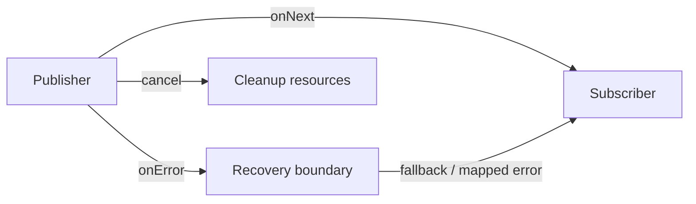

# 177. How does reactive programming handle errors?

> **Section:** Reactive and Modern Approaches · **Related:** [164. What is Reactor](164.%20What%20is%20Reactor.md)

## TL;DR

In a reactive stream, an error is a terminal signal that travels downstream; recovery operators can replace, transform, or retry the failed sequence.

In Reactor, `onErrorResume` can switch to a fallback, `onErrorMap` can translate an error, and `retry` can resubscribe. Retry only with limits, appropriate delay, and operations safe to repeat. Cancellation is a separate signal, not success or an error; release resources on cancellation too.

## Architect insight

Recover at a boundary that understands the business operation. Preserve diagnostics and ensure timeouts and cancellation reach the underlying client.

**Pitfall:** An unbounded retry loop can amplify an outage and repeat non-idempotent side effects.

## Related questions

- [164. What is Reactor](164.%20What%20is%20Reactor.md)
- [176. How does backpressure work in Reactor](176.%20How%20does%20backpressure%20work%20in%20Reactor.md)
