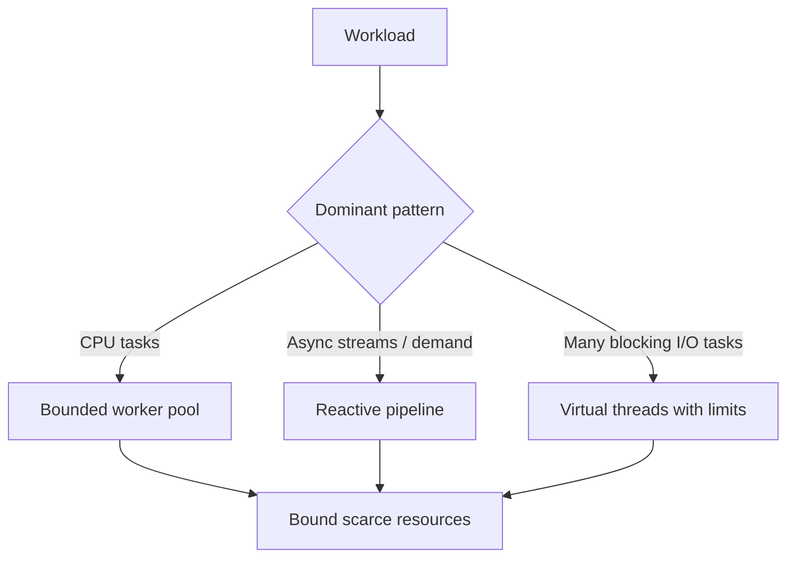

# 178. What is the difference between reactive and traditional thread pools?

> **Section:** Reactive and Modern Approaches · **Related:** [175. What is a scheduler](175.%20What%20is%20a%20scheduler.md)

## TL;DR

Traditional pools schedule tasks onto workers, commonly with blocking calls; reactive systems compose asynchronous signals and use schedulers, often with demand-based flow control.

Reactive can reduce dedicated thread use for I/O-heavy workloads when every layer is genuinely nonblocking, but increases model complexity. Traditional bounded pools remain effective for CPU-bound tasks and blocking integrations. Virtual threads can also support blocking-style I/O concurrency.

## Architect insight

Compare end-to-end throughput, p95/p99 latency, resource usage, and operational complexity. Neither framework choice removes queueing or downstream capacity constraints.

**Pitfall:** Reactive code that calls blocking dependencies on event loops can perform worse than a straightforward bounded pool.

## Related questions

- [168. Async I/O versus thread-per-request](168.%20Async%20I-O%20versus%20thread-per-request.md)
- [174. Blocking calls in reactive systems](174.%20Blocking%20calls%20in%20reactive%20systems.md)
