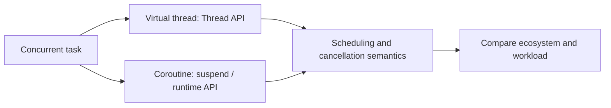

# 179. How do virtual threads compare to coroutines?

> **Section:** Reactive and Modern Approaches · **Related:** [170. What are virtual threads](170.%20What%20are%20virtual%20threads.md)

## TL;DR

Virtual threads are JVM-managed `Thread` instances that support blocking-style Java code; coroutines are suspendable computations provided by a language or runtime.

Virtual threads compose with Java's thread APIs and are scheduled by the JVM. Coroutine APIs may use compiler transformations, explicit suspension points, structured scopes, and ecosystem-specific dispatchers. Cancellation, scheduling, debugging, and interoperability semantics differ by implementation.

## Architect insight

Choose based on language ecosystem, libraries, cancellation requirements, and team familiarity—not on a claim that one abstraction is universally lighter or faster. Benchmark equivalent work.

**Pitfall:** Kotlin coroutine behavior and APIs are ecosystem-specific; do not assume every coroutine model has identical semantics.

## Related questions

- [169. What is Project Loom](169.%20What%20is%20Project%20Loom.md)
- [170. What are virtual threads](170.%20What%20are%20virtual%20threads.md)
