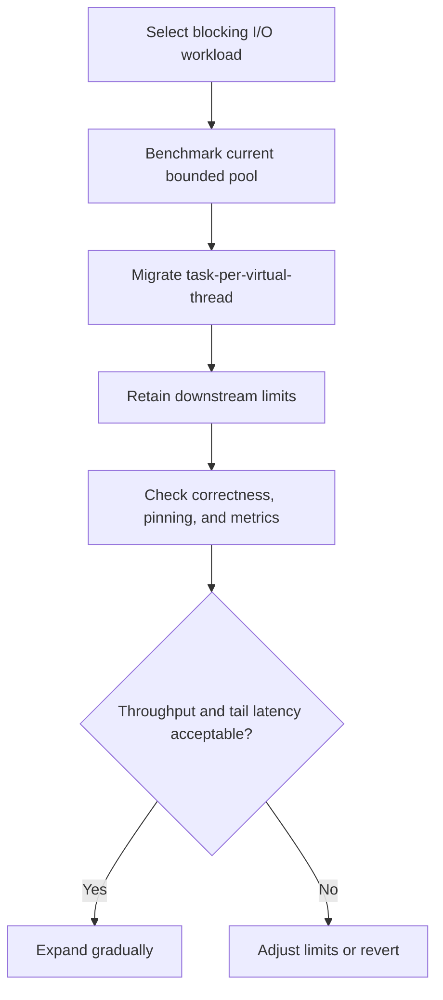

# 180. How do you migrate from thread pools to virtual threads?

> **Section:** Reactive and Modern Approaches · **Related:** [170. What are virtual threads](170.%20What%20are%20virtual%20threads.md)

## TL;DR

Migrate incrementally from task-per-thread or blocking request workloads; preserve resource bulkheads and validate end-to-end behavior before changing capacity limits.

Review `ThreadLocal` assumptions, synchronization, cancellation, observability, and pinning-sensitive operations for the target JDK. Virtual threads are standard in JDK 21+, but runtime and library behavior can vary. Keep bounds for database connections, remote calls, and other scarce resources.



## Example

```java
try (var executor = Executors.newVirtualThreadPerTaskExecutor()) {
    Future<Result> result = executor.submit(this::blockingOperation);
    consume(result.get());
}
```

This API requires a modern JDK with virtual threads (JDK 21+); bound downstream concurrency separately, for example with a semaphore.

## Architect insight

Compare throughput, p95/p99 latency, memory, downstream saturation, and failure recovery against the baseline. Replacing a pool's worker cap must not silently remove an intentional admission limit.

**Pitfall:** “One virtual thread per task” is not permission for unbounded tasks or connections.

## Related questions

- [169. What is Project Loom](169.%20What%20is%20Project%20Loom.md)
- [171. How do virtual threads reduce resource use](171.%20How%20do%20virtual%20threads%20reduce%20resource%20use.md)
