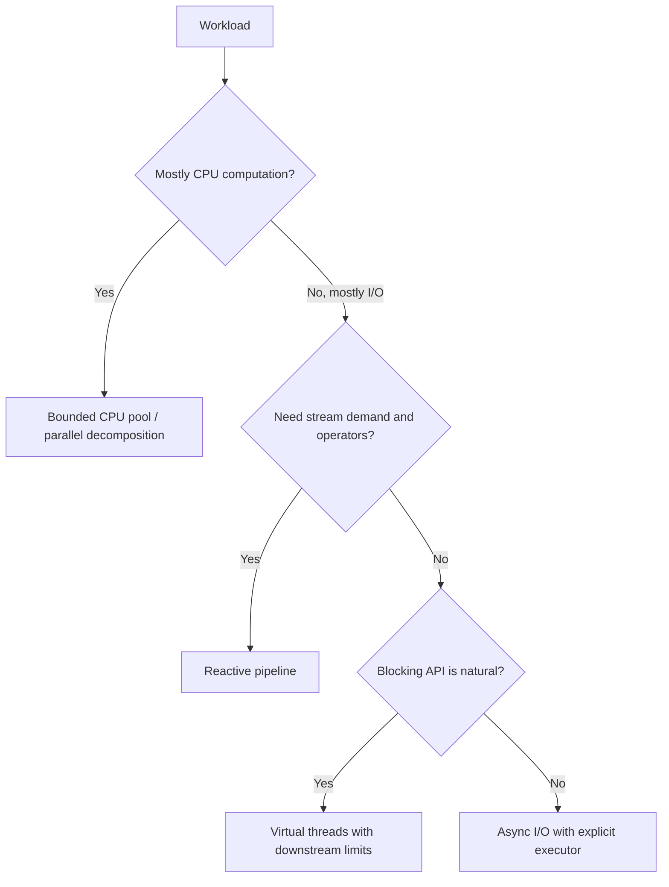
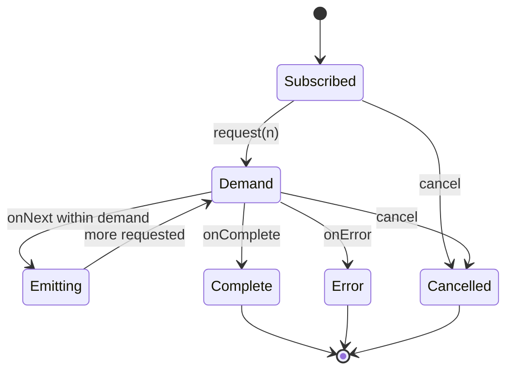
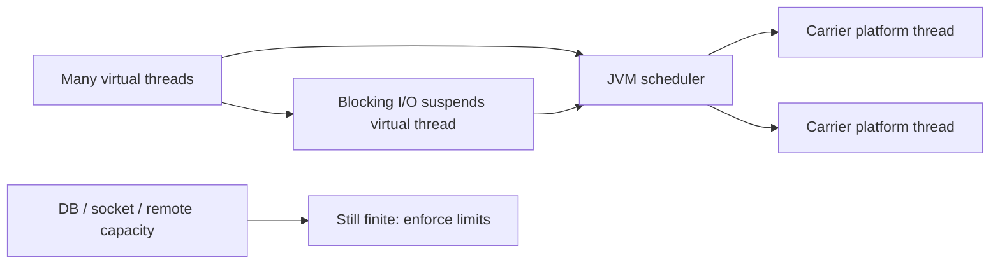

# 9. Reactive and Modern Approaches

> Complete guide to questions 161–180 in the [master index](../00-INDEX.md). Reactive libraries, virtual threads, and structured concurrency are complementary choices, not interchangeable labels.

## Answers

### 161. What are parallel streams?

Parallel streams split stream work into tasks, commonly using the shared `ForkJoinPool`, and combine the results. They suit sufficiently large, independent, CPU-bound operations with associative reductions. They are not a general-purpose executor: blocking, shared mutable state, ordering constraints, or small inputs can erase benefits.

### 162. Parallel streams versus manual threads

Parallel streams provide declarative splitting and reduction with library-managed scheduling; manually managed tasks expose executor choice, cancellation, lifecycle, and task boundaries. Use a stream for a simple data-parallel operation, and an explicit executor or structured task scope when resource isolation, blocking policy, or lifecycle control matters.

### 163. What is reactive programming?

Reactive programming models values and events that arrive over time, composing transformations and asynchronous boundaries. Reactive Streams adds a demand protocol to control flow. It can support high concurrency with fewer threads, but introduces an asynchronous programming model and does not remove the need to reason about state, failures, and resource limits.

### 164. What is Reactor?

Project Reactor is a JVM reactive library centered on `Mono` (zero or one result) and `Flux` (zero to many), with operators, schedulers, cancellation, and Reactive Streams demand. It is common in Spring reactive stacks. Operators are lazy until subscription; keep blocking work off event-loop threads.

### 165. What is RxJava?

RxJava is a JVM implementation of the ReactiveX model, providing observable/flowable streams and operators for composition, scheduling, and error handling. API types differ by version and backpressure support; choose the correct type and explicitly manage subscriptions/disposal to avoid leaks and unwanted work.

### 166. Reactive Streams versus futures

A future typically represents one eventual result; a stream represents zero or many asynchronous values, often with demand and cancellation. `CompletableFuture` composes one-shot stages, while Reactive Streams is suited to ongoing or multi-item flow. Both are asynchronous abstractions and neither automatically guarantees nonblocking dependencies.

### 167. What is asynchronous I/O?

Async I/O lets an operation be initiated and completion observed later without dedicating a waiting application thread to that operation, where the OS/runtime and driver support it. Completion may arrive via callbacks, futures, or event loops. End-to-end nonblocking behavior depends on every layer, including libraries and database clients.

### 168. Async I/O versus thread-per-request

Async I/O uses completion events and often event loops to manage many outstanding operations with fewer threads, but requires async-aware code and careful callback/error flow. Thread-per-request offers straightforward blocking control flow; virtual threads can make it scalable for many blocking I/O requests. Both need downstream limits.

### 169. What is Project Loom?

Project Loom is the OpenJDK effort that introduced lightweight virtual threads and structured-concurrency work to make concurrent Java programs easier to write and scale. Virtual threads are a standard Java feature in modern JDKs; structured concurrency has had release-dependent preview status. Check the target JDK for API availability.

### 170. What are virtual threads?

Virtual threads are lightweight `Thread` instances scheduled by the JVM over a smaller set of carrier platform threads. They support the familiar blocking thread-per-task style and are especially useful for I/O-bound concurrency. They do not make CPU-bound work faster or make shared mutable state safe.

### 171. How do virtual threads reduce resource use?

The JVM can suspend many virtual threads during supported blocking operations without reserving one OS thread per blocked task, reducing the cost of high concurrency. Heap, file descriptors, database connections, and remote service capacity remain finite. Bound those resources with semaphores, pools, and admission control.

### 172. How does structured concurrency improve readability?

It makes child-task lifetimes visible in a lexical scope, groups results and errors, and gives a parent a coherent join/cancel boundary. This reduces orphan tasks and scattered future management. Java API details and preview status vary by JDK; keep the scope short and define sibling-failure policy.

### 173. Risks of parallel streams

Parallel streams may contend on the common pool, starve unrelated tasks, perform poorly on small or unbalanced workloads, and expose race conditions in side effects. Encounter order may constrain performance. Keep operations stateless, use correct reductions, avoid blocking, and benchmark against a sequential baseline.

### 174. Blocking calls in reactive systems

Do not block event-loop threads. Prefer a genuinely asynchronous client; if unavailable, isolate the blocking call on a bounded dedicated scheduler/executor and return its result to the reactive chain. Bound concurrency, propagate cancellation/timeouts, and observe saturation rather than hiding blocking behind an unbounded pool.

### 175. What is a scheduler?

A reactive scheduler controls where and when operators execute: event-loop, single-thread, parallel CPU, or bounded-elastic patterns are common. A scheduler is not just a thread label; its capacity and queueing behavior affect backpressure and latency. Use framework defaults intentionally and isolate blocking work.

### 176. How does backpressure work in Reactor?

Reactor's `Flux` follows Reactive Streams demand: downstream requests a bounded number of elements, and upstream must respect that demand. Operators may buffer or reshape requests, so inspect their behavior and configure bounded queues where available. Backpressure does not protect unrelated resources such as DB connections automatically.

### 177. How does reactive programming handle errors?

Reactive errors are terminal signals in a stream and flow downstream to operators such as `onErrorResume`, `onErrorMap`, or `retry`. Handle errors at a boundary where recovery is meaningful; retries need limits, delay, and idempotency. Cancellation is distinct from success and should release resources.

### 178. Reactive versus traditional thread pools

Traditional pools schedule tasks onto worker threads, often with blocking calls. Reactive systems compose asynchronous signals and use schedulers/event loops, with demand for flow control. Reactive can reduce thread use for I/O-heavy workloads but increases model complexity; thread pools remain effective for bounded CPU work.

### 179. Virtual threads versus coroutines

Virtual threads are JVM-managed threads exposed through Java's `Thread` API and typically use blocking-style code. Coroutines are language/runtime-level suspendable computations, often with structured scopes and compiler transformations. Both can reduce the cost of concurrency, but cancellation, scheduling, and interoperability semantics are ecosystem-specific.

### 180. Migrating pools to virtual threads

Migrate incrementally from task-per-thread or blocking request workloads, replace inappropriate platform-thread limits, and preserve limits for scarce downstream resources. Review `ThreadLocal` assumptions, synchronization, pinning-sensitive operations for the target JDK, cancellation, and observability. Benchmark end-to-end throughput and tail latency before removing existing bulkheads.

## Diagrams

### Choosing a concurrency model

### Reactive demand and terminal signals

### Virtual threads and carrier workers

## Adoption checklist

- Pick the model that fits the workload and ecosystem; do not migrate for novelty alone.
- Keep CPU parallelism bounded and limit scarce dependencies regardless of thread model.
- In reactive code, identify every blocking operator and every queue/buffer.
- In virtual-thread code, review thread-local assumptions and retain admission control.
- Verify API stability and required JDK version before adopting preview features.
